  

I take a manual process in support, payments or sales operations and turn it into a system that runs on its own: the bot people talk to, the database behind it, the dashboard the manager opens in the morning and the alert that fires before a customer notices.

I work alone with a team of coding agents, so a project that usually needs a small department ships in weeks. Every release goes through tests and an independent review first.

## What I can build for you

| You have | You get |
|---|---|
| Operators answering the same questions all day | An AI assistant in Telegram or your chat widget that answers from your price list and knowledge base and hands the hard cases to a human |
| Numbers spread over spreadsheets and admin panels | One dashboard with the metrics you check daily, plus scheduled reports in Telegram or Excel |
| Problems you learn about from customers | Monitoring with alerts that say what broke, since when and how many people it affects |
| Chats nobody has time to review | Automatic quality scoring of every conversation against your own checklist |
| A routine that eats hours every week | A bot or a small internal tool that does it, with an audit trail |

## Selected work

| Project | What it is | Stack |
|---|---|---|
| [processing-hub](https://github.com/joooooooooooooooooooopa-cmd/processing-hub) | Operations platform for a payment processing team: merchant CRM with a Mini App, 10 monitoring and reporting bots, dashboard SQL. 48 API endpoints, about 40 tables, 296 automated checks | Python, FastAPI, React, PostgreSQL, ClickHouse |
| [merchant-ops-bots](https://github.com/joooooooooooooooooooopa-cmd/merchant-ops-bots) | Tools for account managers, support and finance at a payment aggregator: CRM bot with real-time alerts, an AI analyst over the processing database, Excel reports, web dashboard with passkeys | Python, PostgreSQL, FastAPI, OpenAI API |
| [suflyor](https://github.com/joooooooooooooooooooopa-cmd/suflyor) | macOS panel that listens to a live call, transcribes both sides locally and shows a short hint on what to say next. 181 tests | Swift, ScreenCaptureKit, whisper |
| [grailert](https://github.com/joooooooooooooooooooopa-cmd/grailert) | Multi-user bot that watches marketplace searches and alerts resellers the moment a listing goes live. Paid plans, Mini App, 7 languages | Python, SQLite |
| [domainscan](https://github.com/joooooooooooooooooooopa-cmd/domainscan) | Domain trust scanner: 8 parallel checks, a 0-100 score with an explainable breakdown and a PDF report | Python, asyncio, FastAPI |
| [replly](https://github.com/joooooooooooooooooooopa-cmd/replly) | AI sales assistant for small businesses in Telegram: answers customers around the clock, collects bookings, passes tricky questions to the owner | Python, aiogram, SQLAlchemy |

All repositories are anonymized copies of systems that ran in production. Names, data and credentials are synthetic.

## How a project goes

1. A short call or a written brief: what hurts and how you will know it is fixed.
2. A fixed scope and price for the first working version, usually one to three weeks.
3. You get the code, the deployment on your own server and a runbook. It keeps working without me.

## Contact

Telegram: [@CRM_AI_in](https://t.me/CRM_AI_in)  
Email: danilahhh4@gmail.com

Tbilisi time, UTC+4. I reply within one working day. English and Russian.
