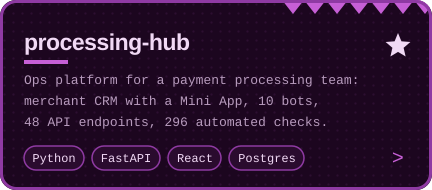
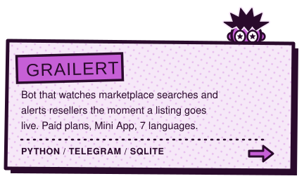
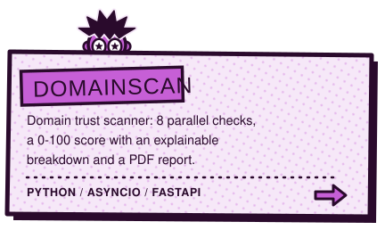

I take a manual process in support, payments or sales operations and turn it into a system that runs on its own: the bot people talk to, the database behind it, the dashboard the manager opens in the morning and the alert that fires before a customer notices.

I work alone with a team of coding agents, so a project that usually needs a small department ships in weeks.

## What I can build for you

| You have | You get |
|---|---|
| Operators answering the same questions all day | An AI assistant in Telegram or your chat widget that answers from your price list and knowledge base and hands the hard cases to a human |
| Numbers spread over spreadsheets and admin panels | One dashboard with the metrics you check daily, plus scheduled reports in Telegram or Excel |
| Problems you learn about from customers | Monitoring with alerts that say what broke, since when and how many people it affects |
| Chats nobody has time to review | Automatic quality scoring of every conversation against your own checklist |
| A routine that eats hours every week | A bot or a small internal tool that does it, with an audit trail |

## Selected work

All repositories are anonymized copies of systems that ran in production. Names, data and credentials are synthetic.

## How a project goes

1. A short call or a written brief: what hurts and how you will know it is fixed.
2. A fixed scope and price for the first working version, usually one to three weeks.
3. You get the code, the deployment on your own server and a runbook. It keeps working without me.

## Contact

Tbilisi time, UTC+4. I reply within one working day. English and Russian.
